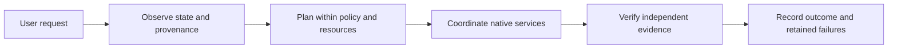

# Diatonic OS

**An agentic foundation for infrastructure, filesystems, and media workflows.**

Built by **Chromatix Studios**. **Drew Fortini — Founder · [@iamdrewfortini](https://github.com/iamdrewfortini)**.

**10-Day Build Exploration · Meta Hackathon**

Diatonic OS explores a shared foundation for understanding system state, coordinating bounded work, and verifying outcomes across cluster management, files, and media. This repository brings together the application showcase, architecture, build journey, and reusable components.

## Try the showcase

**[Open the demo](https://iamdrewfortini.github.io/diatonic-os/)** · [Agent SDK](https://github.com/iamdrewfortini/diatonic-agent-sdk) · [RMM](https://github.com/iamdrewfortini/diatonic-rmm)

Or run locally, without accounts, keys, models, or a cluster:

```sh
git clone --recurse-submodules https://github.com/iamdrewfortini/diatonic-os.git
cd diatonic-os
python3 -m http.server 8080 --bind 127.0.0.1 --directory showcase
```

Open `http://127.0.0.1:8080`. Run the built-in sample or choose a file, video, or audio asset up to 100 MiB. The application plans a bounded workflow, reads the bytes twice, computes SHA-256, checks content identity, and exports a verification receipt. Audio/video previews and duration are provided by the browser. Selected assets stay on your device.

Infrastructure cards use explicitly synthetic data. This demo makes no provider requests, provisions no resources, and grants no production authority. Browser metadata is not transcription, generation, or a server-side media pipeline.

## Architecture



| Component | Responsibility | Repository |
| --- | --- | --- |
| Diatonic OS | Showcase, architecture, build narrative, and component assembly | This repository |
| Diatonic Agent SDK | Provider-neutral contracts, filesystem projections, bounded execution, audit, signed-release staging, and verification | `repos/agent-sdk` |
| Diatonic RMM | Authenticated observer API, wall projections, and edge components | `repos/rmm` |

Rucio, FTS, Temporal, inference gateways, and native host controls retain their own responsibilities. An agent plan does not grant permissions, prove capacity, or establish that an effect succeeded.

## What we built

- Provider-neutral agent and workflow contracts with explicit capabilities and budgets.
- Bounded filesystem observation and fixture-scoped file-operation verification.
- Authenticated, read-only native RMM observations with TLS, freshness, and cursor checks.
- Signed offline updates and bounded maintenance in the originating private deployment.
- A signed release-feed staging adapter that checks artifacts without activating them.
- A metadata-only credential preflight that makes missing prerequisites visible.
- A local showcase that makes the observe → plan → coordinate → verify model tangible.

## What the evidence means

The originating environment's 0.3.5 candidate passed 378 source tests and the same 378 tests against its installed wheel. A cluster CI subset passed 47 cases against source and 47 against the installed wheel. These counts overlap and precede public-export sanitization; public CI is the authority for these exported repositories.

One bounded native RMM acceptance returned 128 fresh observations. A separate signed-feed acceptance staged 55 verified wheel artifacts in isolated management scratch without activating them. The accepted estate service remained at 0.3.4. This does not establish broad production acceptance.

The build also measured an 85.425% reduction in a held-out local evidence payload, accompanied by **worse throughput**. That tradeoff remains part of the record; it is not a claim of faster production processing or lower provider cost.

## Current boundaries

| Surface | Current scope |
| --- | --- |
| Infrastructure/RMM | Implemented observation and scoped native read acceptance; broader remediation remains pending |
| Filesystems | Bounded observations and authorized fixture operations; no estate-wide mutation claim |
| Video and voice | Local browser preview/metadata in the showcase; production modality bindings remain pending |
| Provider execution | Explicit routes and controls; production entitlement, pricing, identity, and accounting acceptance remain pending |
| Release delivery | Signed distribution and staging verified in the originating environment; unattended deployment identities remain separate |

Read the [build journey](docs/BUILD-JOURNEY.md), [demo guide](docs/DEMO.md), [publication notes](docs/PUBLICATION.md), and [security policy](SECURITY.md).

## Development and CI

```sh
npm test
npm run check
```

The showcase has no runtime npm dependencies. GitHub Actions and GitLab CI run the local verification tests and syntax checks. GitHub Pages deploys the static showcase from the main branch; it receives no production credentials. Component repositories independently test and build their packages using public dependency sources.

## Ownership

Copyright © 2026 Chromatix Studios. Drew Fortini, Founder. Public source visibility does not imply an open-source license; see [LICENSE.md](LICENSE.md). Third-party dependencies retain their own licenses.

“Meta Hackathon” describes the build context. This project does not claim endorsement or affiliation from Meta.
